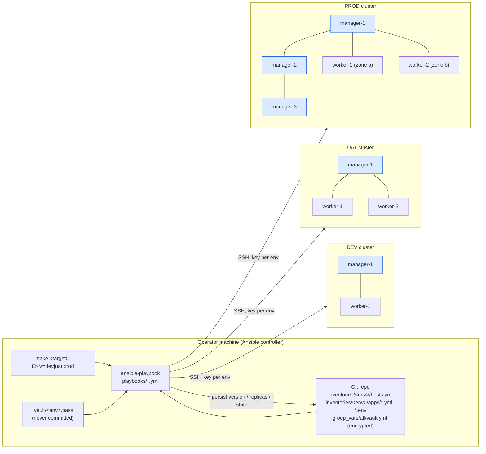
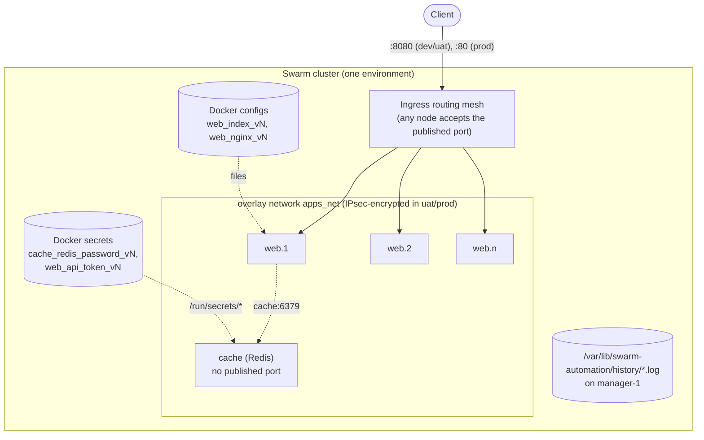
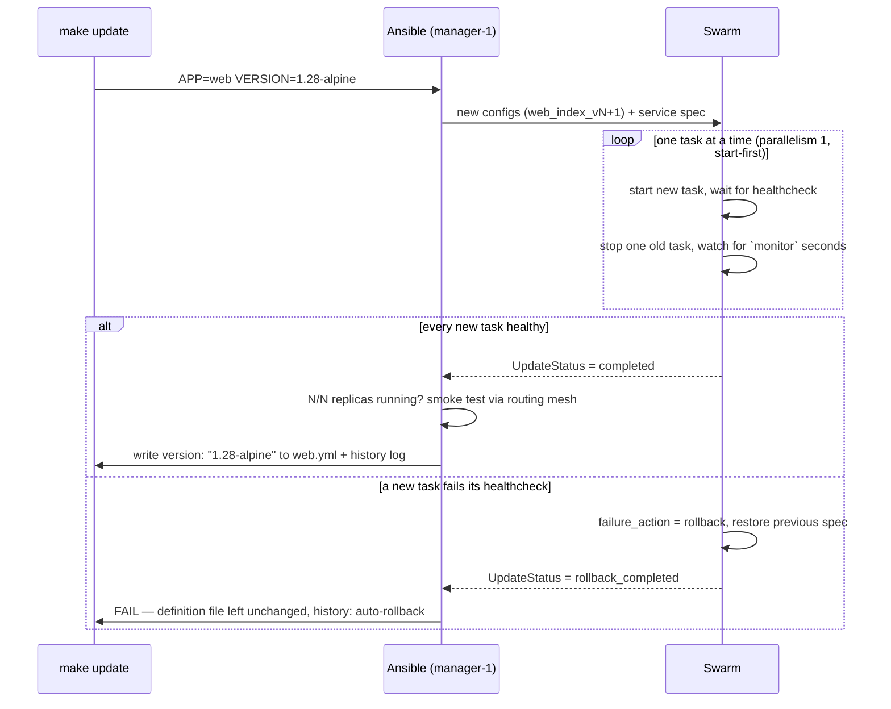
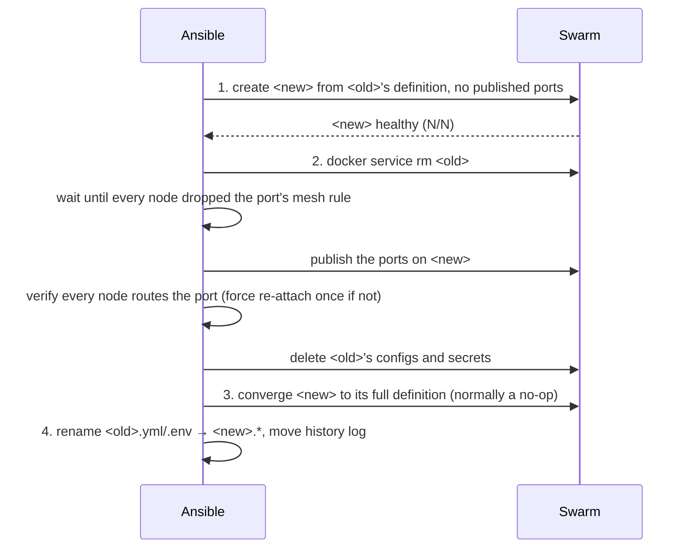

# Architecture

## Control flow

Everything starts from the operator's machine. `make` picks the environment's
inventory and vault, runs one Ansible playbook, and the playbook does all of its
work against the **bootstrap manager**: the first host under `managers` in that
environment's inventory. Only cluster lifecycle work (prepare, join, firewall,
node removal) touches the other nodes directly.



The three clusters share nothing: each has its own inventory, SSH key, vault
password, Swarm (Raft store, join tokens, CA) and application definitions.

## Inside one cluster



## Where each setting comes from

An application's final spec is merged in this order (later wins):

```
roles/swarm_app/defaults/main.yml   swarm_app_defaults  (rolling update, restart=any, ...)
inventories/<env>/group_vars/all    app_env_defaults    (per-environment rollout speed, placement)
inventories/<env>/apps/<app>.yml    the definition      (image, version, replicas, ports, configs, secrets, healthcheck)
inventories/<env>/apps/<app>.env    plain env vars      (make env-set / env-unset)
playbook overrides                  e.g. VERSION= / REPLICAS= for this run
vault_app_secrets (vault.yml)       secret values, referenced by key only
```

## Rolling update and automatic rollback



Configs and secrets are immutable in Swarm, so a changed value becomes a new
object `<app>_<name>_v<N>`, which the service switches to in the same rolling
update. The current and previous generations are kept, so that
`docker service rollback` still has its files.

## Rename

Swarm has no rename, so `make rename` re-creates the service under the new
name and hands the published ports over:



The port is unserved between removing `<old>` and `<new>`'s first task
passing its health check on the routing mesh, measured at about 8–10 s on AWS
and 14 s in the lab. Apps without published ports have no gap. Two things that look like
shortcuts but don't work:

* **Starting `<new>` on temporary ports and switching them later:** Swarm
  does not re-program the routing mesh when a service that is already on it
  changes ports. The port went dead until the tasks were force-restarted.
* **Publishing on `<new>` before every node has released `<old>`'s rule:**
  both services program the same iptables rule, so `<old>`'s asynchronous
  cleanup can delete it.
